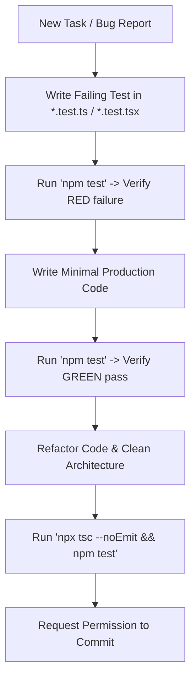

# Test-Driven Development (TDD) Mandatory Rules & Quality Gates

This file establishes **Test-Driven Development (TDD)** as a permanent, non-negotiable architectural requirement for the **iDJ** codebase.

---

## 🚨 The TDD Commandments

1. **Test-First Development**:
   - Every feature, refactor, performance optimization, or bug fix MUST begin with a failing automated test (`RED`).
   - You are strictly forbidden from writing implementation code before the associated test is written and confirmed failing.
2. **Commit Policy**:
   - Commits are strictly prohibited if:
     - `npm test` fails.
     - Coverage is regressed.
     - `npx tsc --noEmit` reports type errors.
3. **Mocking Boundaries**:
   - **Web Audio API**: `AudioContext`, `AudioWorkletNode`, and `AudioBuffer` MUST be mocked using [`src/test/setupTests.ts`](file:///c:/Users/Avell/Documents/martins-software-i-dj/src/test/setupTests.ts). Real audio hardware contexts must never run inside Node/jsdom test runners.
   - **Web MIDI API**: Never depend on attached USB hardware. All MIDI controllers must be simulated via `MockMIDIAccess` and `MockMIDIInput` using raw 3-byte packets (`Uint8Array`).
   - **Electron IPC**: Mock all IPC calls (`invoke`, `send`, `on`). Never execute native desktop processes in unit tests.
   - **Canvas 2D**: HTML5 canvas rendering must use mocked 2D context methods.

---

## 🔄 The Development Workflow

---

## 🛠️ Reference Runbook

For full testing patterns, mocks, and domain examples, consult the dedicated skill:
- **TDD Senior Skill**: [`.agents/skills/test-driven-development/SKILL.md`](file:///c:/Users/Avell/Documents/martins-software-i-dj/.agents/skills/test-driven-development/SKILL.md)
